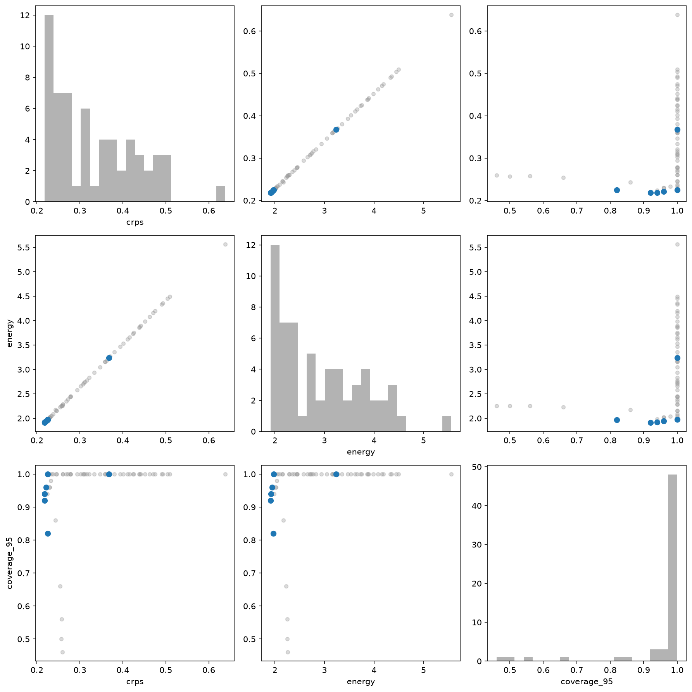
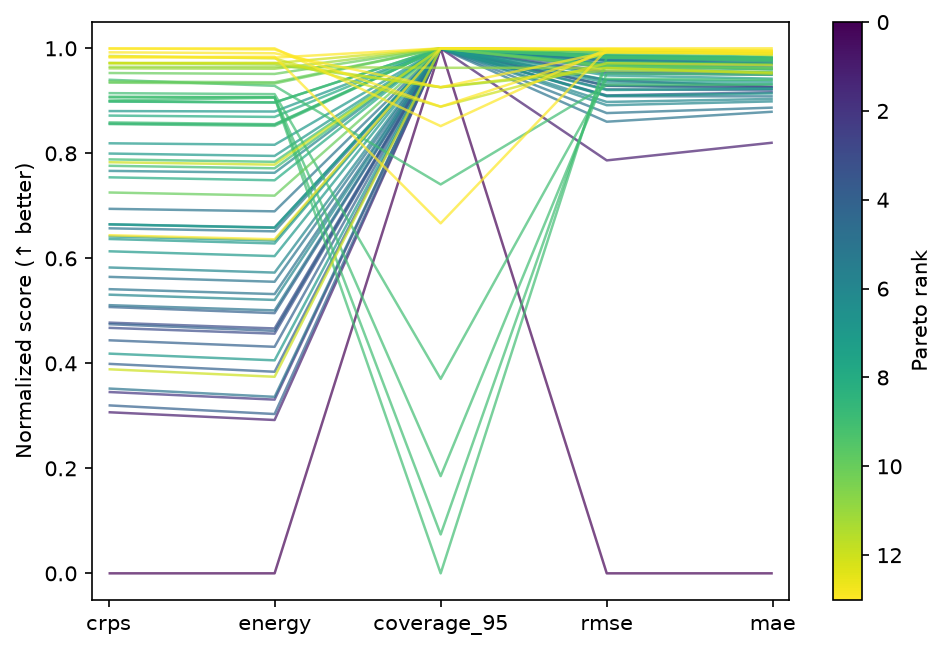
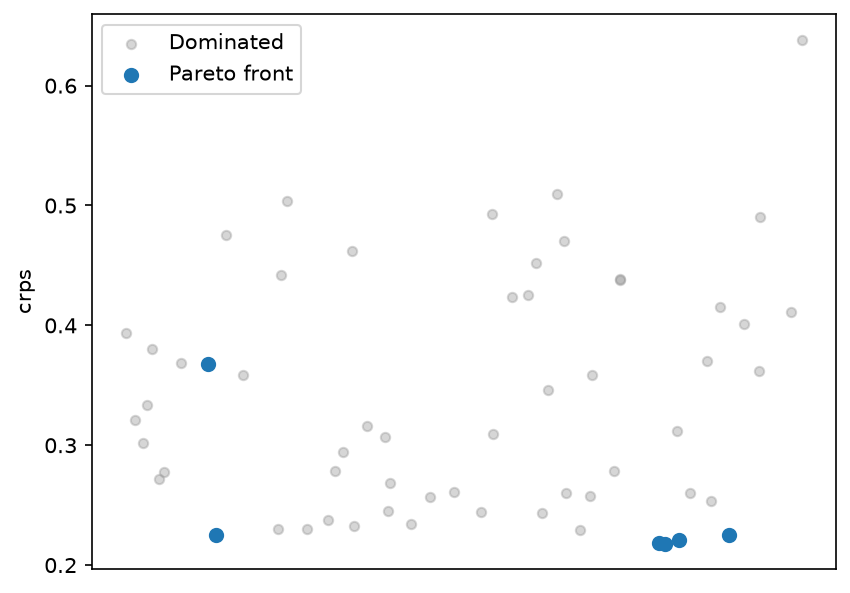
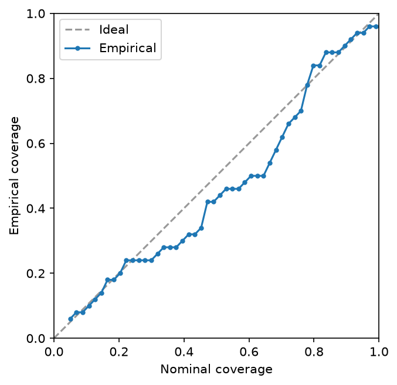

# Bayesian Model Criticism

This tutorial compares Bayesian models using predictive scores, empirical
coverage, and score-based model weights.

The model is a conjugate Bayesian linear regression implemented in NumPy.
It uses a closed-form posterior. The study uses the `examples` extra for scoring,
design, optimization and plots.

!!! tip "Run it yourself"

    The full runnable script is at
    [`examples/bayesian_study.py`](https://github.com/jcm-sci/trade-study/blob/main/examples/bayesian_study.py).

    ```bash
    uv run --extra examples python examples/bayesian_study.py
    ```

## The problem

We want to fit a Bayesian regression
$y = a + bx + \varepsilon$
where $\varepsilon \sim \mathcal{N}(0,\sigma_\text{true}^2)$ and the
true coefficients are known ($a=2$, $b=3$, $\sigma_\text{true}=0.5$).

The study examines how prior variance, assumed noise, and sample size affect
predictive scores and empirical coverage. Each configuration sets three factors:

| Factor | Meaning |
|--------|---------|
| `prior_var` | Variance of the Normal prior on $(a, b)$ |
| `noise_scale` | Assumed observation noise $\sigma$ (may disagree with truth) |
| `n_obs` | Number of training observations |

Changing `noise_scale` affects posterior uncertainty and predictive intervals.
A tight zero-centered prior (`prior_var` small) pulls coefficient estimates
toward zero. More observations can reduce parameter uncertainty, but predictive quality also
depends on the prior and noise assumptions.

## Ground-truth model

```python
--8<-- "examples/bayesian_study.py:model"
```

## Conjugate posterior

Because we use a Normal prior with known noise variance, the
posterior over regression coefficients is available in closed form.
Given design matrix $\mathbf{X}$ and prior precision
$\boldsymbol{\Lambda}_0 = \sigma_\text{prior}^{-2}\mathbf{I}$:

$$
\boldsymbol{\Sigma}_n
  = \left(\boldsymbol{\Lambda}_0
    + \frac{\mathbf{X}^\top\mathbf{X}}{\sigma^2}\right)^{-1}
\qquad
\boldsymbol{\mu}_n
  = \boldsymbol{\Sigma}_n
    \frac{\mathbf{X}^\top\mathbf{y}}{\sigma^2}
$$

We draw posterior predictive samples by projecting coefficient draws
through the test design matrix and adding observation noise.

```python
--8<-- "examples/bayesian_study.py:posterior"
```

## Simulator and scorer

The **simulator** generates training data from the true model, fits
the conjugate posterior, and returns posterior predictive samples at
held-out test locations.  The **scorer** evaluates five complementary
metrics:

- **CRPS** (Continuous Ranked Probability Score), a univariate proper scoring rule.
- **Energy score**, a multivariate proper scoring rule
  complementary to CRPS.
- **Coverage (95 %)**, the fraction of test points whose outcome
  falls inside the 95 % posterior predictive interval.
- **RMSE**, root mean squared error of the posterior mean.
- **MAE**, mean absolute error of the posterior mean.

Marginal CRPS/coverage use `(test_location, member)` samples. Joint energy
uses `(member, variable)`, so the scorer transposes the same array.

```python
--8<-- "examples/bayesian_study.py:world"
```

## Observables and factors

The example scales energy and coverage by 0.5 and MAE by 0.3. Positive
scaling preserves Pareto membership; it does not express a preference during
non-dominated sorting. A wide interval can achieve high empirical coverage while
CRPS penalizes its spread. Use explicit weighted-sum or preference policies to
choose among the five-objective alternatives.

```python
--8<-- "examples/bayesian_study.py:observables"
```

```python
--8<-- "examples/bayesian_study.py:factors"
```

## Annotations

An `Annotation` attaches external metadata. This example uses a linear
cost model for the number of observations:

```python
--8<-- "examples/bayesian_study.py:annotation"
```

## Constraints

A `Constraint` defines a hard feasibility bound on an observable.
`feasibility_filter` builds a phase filter that drops any design
violating the constraints:

```python
--8<-- "examples/bayesian_study.py:constraint"
```

## Factor screening

Before running the full grid, Morris screening identifies which
factors influence the scores most.  `reduce_factors` drops any
factor whose $\mu^*$ falls below a threshold:

```python
--8<-- "examples/bayesian_study.py:screening"
```

## Grid evaluation

A 60-point Latin hypercube covers the three-factor space.  `run_grid`
evaluates every configuration and collects scores and annotations into
a `ResultsTable`:

```python
--8<-- "examples/bayesian_study.py:run"
```

## Pareto analysis

```python
--8<-- "examples/bayesian_study.py:results"
```

### Pareto front scatter matrix



There are five objectives. `plot_front` displays pairwise projections of the
first three (CRPS, energy and coverage), while marking membership of the full
five-objective front. Projection alone does not determine that membership.
Compare the five objectives jointly when interpreting a model choice.

### Parallel coordinates



Each line shows a configuration. Compare its prior variance and assumed noise
with its predictive scores and empirical coverage.

### CRPS strip plot



## Quality indicators

`hypervolume` measures the dominated volume of the Pareto front;
`igd_plus` (inverted generational distance plus) measures how close
the front is to a reference set. Both depend on the chosen objectives,
scaling, and references:

```python
--8<-- "examples/bayesian_study.py:igd_plus"
```

## Feasibility filtering

Apply `Constraint` + `feasibility_filter` to keep only designs
meeting hard bounds (here, `coverage_95 >= 0.90`):

```python
--8<-- "examples/bayesian_study.py:feasibility"
```

## Weighted-sum filtering

`weighted_sum_filter` scalarises objectives into a single score
via min-max normalisation and weighted combination, then keeps
the top-K designs.  Useful when you want a simple ranking
without full Pareto analysis:

```python
--8<-- "examples/bayesian_study.py:weighted_sum"
```

## Sobol grid

`build_grid(method="sobol")` generates a quasi-random Sobol design:

```python
--8<-- "examples/bayesian_study.py:sobol"
```

## Study workflow

The `Study` class orchestrates multi-phase workflows.
`Study.summary()` returns per-phase statistics and
`Study.stack()` computes stacking weights directly:

```python
--8<-- "examples/bayesian_study.py:study_workflow"
```

## Score-based stacking

`stack_scores` minimizes a weighted average of the supplied per-model scores.
Here those inputs are squared errors. This is a linear objective in the weights,
so the solution selects models with the best mean input score, splitting weight
uniformly across exactly tied best means. Selection is independent of positive
score rescaling, subject to floating precision. See
[choosing ensemble weights](stacking.md) for the supported inputs and tie policy.
It does not optimize the squared error of the combined prediction or promise
improvement over every model. The example computes that prediction and its RMSE
separately. These weights use the same test values shown in the comparison; an
independent evaluation set is needed to assess performance after selection:

```python
--8<-- "examples/bayesian_study.py:stacking"
```

## Calibration assessment

`coverage_curve` evaluates empirical coverage at many nominal levels.
A calibrated predictive distribution should track the diagonal across suitable
repeated data. This illustration uses one test set after model selection; it is
an empirical coverage plot, not a powered SBC or calibration certification:

```python
--8<-- "examples/bayesian_study.py:calibration"
```



## Persistence

`save_results` writes the `ResultsTable` to disk; `load_results`
reconstructs it.  Useful for expensive studies where you want to
separate evaluation from analysis:

```python
--8<-- "examples/bayesian_study.py:persistence"
```

## Multi-fidelity workflow

MCMC fitting, fine-mesh numerical solvers, and agent-based models can be
expensive to evaluate. A multi-phase study can screen designs with a cheaper
calculation and re-evaluate a selected subset with a more detailed one.

`Phase` supports this via optional `world` and `scorer` overrides.
When set, a phase uses its own simulator instead of the `Study`-level
default. Here the first simulator draws 50 posterior samples,
while the second phase draws
2 000:

```python
--8<-- "examples/bayesian_study.py:multifidelity"
```

The `Study` orchestrates both phases: the first screens 60 designs
with the cheap surrogate and keeps the top 10 by Pareto rank, then
the second re-evaluates those 10 designs with the expensive model.

This pattern applies whenever fidelity is a computational strategy
rather than a design factor:

- **Epidemiology.** Screen surveillance designs with a deterministic
  model and re-evaluate a subset with a stochastic agent-based model.
- **Engineering.** Explore with a coarse mesh and re-evaluate a subset
  on a finer mesh.
- **Forecast model assessment.** Use approximate inference for screening
  and HMC for a later phase.

Comparisons across fidelities need compatible targets and explicit model
assumptions. A later phase alone does not validate those assumptions.

## What to try next

- Try `stack_bayesian()` on models that expose log-likelihood
  (requires `arviz`).
- Add more phases to the `Study`, such as a third phase that
  re-evaluates with even higher fidelity.
- Experiment with different `weighted_sum_filter` weight vectors
  to explore different trade-off preferences.
