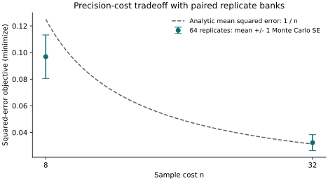

# Capabilities and executable examples

`trade-study` orchestrates domain-supplied simulators and scorers. Its core
requires only NumPy. Optional libraries provide designs, Pareto algorithms,
scoring, optimization and plotting; statistical estimators belong to the caller.

## Choose a public interface

| Task | Implemented interface | Dependency and boundary |
| --- | --- | --- |
| Declare factors and objectives | `Factor`, `FactorType`, `Observable`, `Direction`, `Constraint` | Core; bounds and feasibility are caller-defined. |
| Construct designs or screen factors | `build_grid`, `FactorConstraint`, `screen`, `sobol_indices` | Full discrete factorial is core; sampled designs/sensitivity need `design`. |
| Evaluate a fixed replicated grid | `run_grid`, `ResultsTable.aggregate_replicates` | Core; optional `parallel` for workers. Supply `generate(..., rep=...)` to vary randomness. |
| Compare paired designs | `paired_difference`, `paired_rank` | Core bootstrap; t intervals need SciPy. Nonfinite pairs are excluded and `n_pairs` is reported. |
| Allocate replication | `run_sequential`, `ReplicationPolicy` | Fixed or adaptive policy with recorded bounds, counts and assumptions; power is not automatically certified. |
| Plan fixed proportion precision | `proportion_interval`, `replicates_for_half_width` | [Proportions guide](proportion-intervals.md); Wilson precision is not a power calculation or sequential interval. |
| Select nondominated alternatives | `extract_front`, `pareto_rank`, `hypervolume`, `igd_plus` | `pareto`; positive objective scaling preserves front membership. |
| Report decisions across preferences | `preference_sweep`, `PreferencePolicy` | Regret, practical equivalence and optional paired uncertainty; preferences are specified by the caller. |
| Chain study phases | `Study`, `Phase`, phase filters | Requirements follow each chosen filter/runner; preserve reproducibility between phases. |
| Optimize or allocate fidelity | `run_adaptive`, `AdaptiveSession`, `run_successive_halving`, `run_hyperband` | `adaptive` for Optuna; persistent sessions retain their declared objective/constraint contract. |
| Fit validated response models | `fit_surrogate`, `fit_regime_surrogate`, `sensitivity_from_table` | `surrogate` plus optional `design`; inspect grouped validation and support diagnostics. |
| Score and combine predictions | `score`, `coverage_curve`, `stack_scores`, `stack_proportional`, `stack_bayesian`, `ensemble_predict` | NumPy core selects score weights and combines predictions; scoring/Bayesian integrations use their extras. See [weight contracts](stacking.md). |
| Cache, resume and publish results | `EvaluationCache`, grid checkpoints, `save_result_bundle`, `load_result_bundle`, `publish_result_bundle` | Core; [bundles](result-bundles.md) require independently supplied expected provenance for guarded reuse. |
| Export or plot | `ResultsTable.to_dataframe`, plotting helpers | `dataframe` or `viz`. |

The API reference contains the detailed signatures. `op_infer` composes these
runners with calibration and inference callbacks; trade-study supplies no
posterior sampler, model likelihood or HPC scheduler.

## A complete replicated study

The [README quickstart](https://github.com/jcm-sci/trade-study#quick-start) and
[`examples/replicated_study.py`](https://github.com/jcm-sci/trade-study/blob/main/examples/replicated_study.py)
compare sample means using 8 versus 32 observations. A fixed bank of 64 independent
replicates shares nested sample banks across designs. Costs are exactly 8 and 32;
errors are compared by replicate before aggregation and Pareto extraction.



--8<-- "docs/assets/replicated-study/summary.txt"

For independent standard-normal observations, the sample mean's expected
squared error is `1 / n`. The finite bank's empirical mean varies around this
reference. The error bars show one estimated Monte Carlo standard error of
each mean, rather than a confidence level or a calibration verdict. Both
sampled designs are nondominated for the observed error and exact cost; the
paired contrast retains the 64 shared replicate identities.

[Download the vector PDF](../assets/replicated-study/figure.pdf).
The checked table is included directly from the generated artifact:

```bash
uv run --python 3.12 --extra dev --with matplotlib==3.11.2 python examples/illustrate_replicated_study.py
just figures-check
```

The check reruns the actual study, compares the complete plotted data and table,
and validates source/export fingerprints. It needs the Pareto extra but no
plotting dependency. Regeneration also saves the
[plotted data](../assets/replicated-study/data.json).

```bash
uv sync --extra dev
just example-replicates
just doctest
```

The example is a precision/error-cost demonstration. It supplies no calibration
or power certification. Declare failure handling before choosing a success-only
paired comparison; bootstrap resamples are not additional independent cohorts.

For larger workflows use the [CSTR](cstr.md), [sklearn](sklearn.md),
[assay](assay.md), [serosurvey](serosurvey.md), [monitoring](monitoring.md) and
[Bayesian criticism](bayesian.md) guides. The serosurvey notebook combines
context grids, sampling frames, paired comparisons, decisions and result bundles.

## What runs automatically

Default pytest and CI now collect source docstrings as well as tests. Public
examples cover grids/constraints, aggregation, Wilson precision, Pareto sorting,
scoring layouts and ensemble prediction. `just doctest` also executes the actual README and
standalone replicated study and checks their agreement and known costs. CI runs
the larger CSTR/sklearn/assay workflows and serosurvey scripts/notebook separately.
Monitoring and Bayesian figure-generation scripts run in a scratch directory,
with a known-answer energy-score regression test for the Bayesian scorer.

Maintain complete executable entry points and independently check a known
quantity or invariant. Optional examples must declare their extra and run in a
job that requires it; skipped optional tests are not qualification evidence.
Run `just ci` before every commit, `just build-all` for wheel validation, and
`uv run mkdocs build --strict` for documentation changes.
