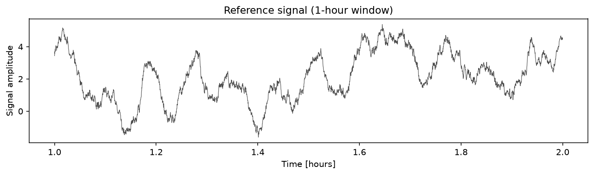
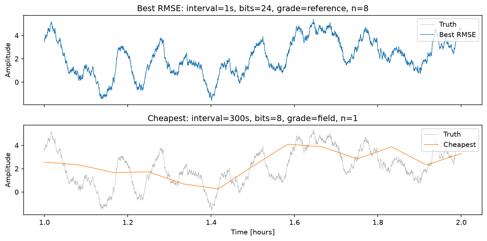
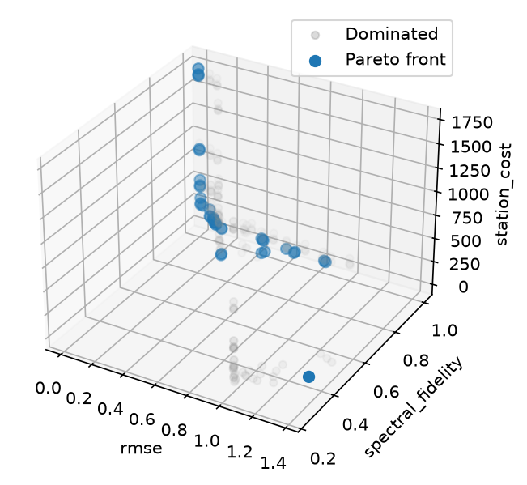
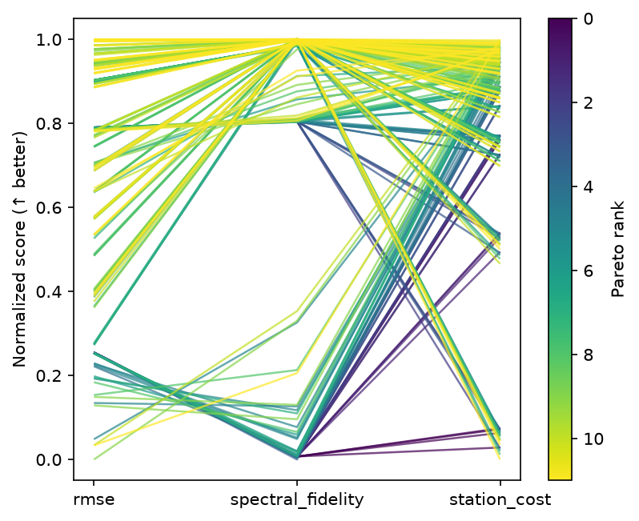
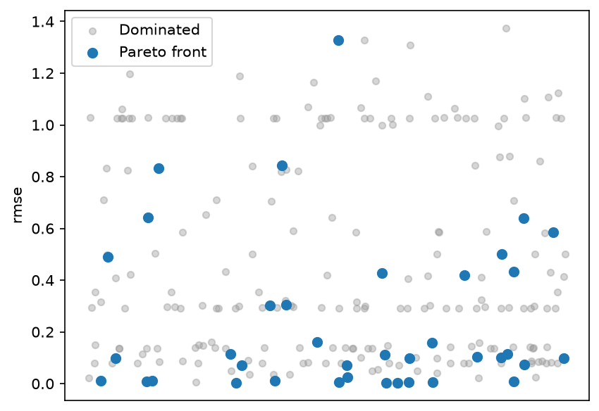

# Monitoring Station Design

This tutorial runs a **multi-objective trade study** over instrument
settings for a remote monitoring station.  The goal is to recover a
known environmental signal as faithfully as possible while keeping
station cost low.

The underlying signal is fixed. Designs vary the instrument configuration
used to observe it.

!!! tip "Run it yourself"

    The full runnable script is at
    [`examples/monitoring_study.py`](https://github.com/jcm-sci/trade-study/blob/main/examples/monitoring_study.py).

    ```bash
    uv run python examples/monitoring_study.py
    ```

## The problem

A reference environmental signal is measured at a remote station.
The instrument settings include sample rate, ADC resolution, sensor quality,
and the number of co-located sensors. These affect how closely the reference
signal is recovered and how much the station costs.

### Reference signal

A synthetic 24-hour signal with three components (numpy only):

- **Diurnal cycle**: smooth sinusoid with a 24-hour period.
- **Short-period oscillations**: two modes at periods of 5 minutes and
  20 minutes, chosen to illustrate finite sampling resolution.
- **Correlated noise**: an AR(1) process ($\varphi = 0.995$,
  decorrelation time $\approx 200$ s) representing natural variability.

The signal is generated at 1-second resolution, with $N = 86\,400$ samples
for a full day.

### Observation model

The simplified observation model applies four transformations:

1. **Anti-alias filter.** Brick-wall low-pass at the Nyquist frequency
   of the configured sample rate.
2. **Decimation.** Subsample to the configured interval.
3. **Quantization.** Finite ADC resolution maps continuous values to
   $2^b$ discrete levels.
4. **Sensor noise.** Additive Gaussian noise whose standard deviation
   depends on sensor grade, reduced by $\sqrt{n}$ averaging when
   multiple co-located sensors are used. The reduction assumes independent
   sensor errors.

### Why the objectives conflict

- Faster sampling, more bits, and additional sensors change reconstruction
  error and the example's assumed station cost.
- Coarse sampling removes variation above the Nyquist frequency, while limited
  ADC resolution introduces quantization error.
- A budget constrains which combinations of sampling and sensor settings are
  feasible.

## Reference signal generation

The plot below shows a 1-hour window of the latent truth, revealing
the diurnal trend, the short-period oscillations, and the correlated
noise component:



```python
--8<-- "examples/monitoring_study.py:signal"
```

## Observation model

The `observe()` function implements the four-stage signal chain
described above.  Each stage is a few lines of numpy:

```python
--8<-- "examples/monitoring_study.py:observation"
```

## Simulator and scorer

The **Simulator** applies the observation model with a per-config
deterministic seed.  The **Scorer** computes three objectives:

| Observable | Direction | What it measures |
|------------|-----------|------------------|
| RMSE | minimize | RMS error after interpolating back to the reference grid |
| Spectral fidelity | maximize | Fraction of spectral power recovered in the 10 min – 2 h band |
| Station cost | minimize | Additive cost model over sample rate, ADC, grade, and sensor count |

```python
--8<-- "examples/monitoring_study.py:world"
```

## Define observables and factors

**Observables** declare what we measure and which direction is better:

```python
--8<-- "examples/monitoring_study.py:observables"
```

**Factors** define the instrument search space.  The full factorial
grid is $5 \times 4 \times 3 \times 4 = 240$ configurations:

```python
--8<-- "examples/monitoring_study.py:factors"
```

## Run the sweep

`build_grid` with `method="full"` generates every combination.
`run_grid` evaluates them all and returns a `ResultsTable`:

```python
--8<-- "examples/monitoring_study.py:run"
```

## Inspect the Pareto front

The Pareto front retains evaluated configurations for which no other design
is at least as good on every objective and strictly better on one. It describes
the sampled configurations under this signal and cost model.

```python
--8<-- "examples/monitoring_study.py:results"
```

### Best vs cheapest Pareto designs

The comparison below overlays the observed signal (coloured) on the
ground-truth reference (grey) for the two extreme Pareto members:



Compare the retained short-period variation, quantization, and noise in the
two configurations. Their differences depend on the assumed signal and
instrument model.

### Pareto front scatter



Each dot is one instrument configuration in a 3-D plot of RMSE, spectral
fidelity and cost; highlighted points are nondominated within this grid.
The three coordinates show the sampled budget trade-off.

### Parallel coordinates



Every line is one design, coloured by Pareto membership. The coordinates
compare reconstruction error, spectral fidelity, and assumed station cost.

### RMSE strip plot



Scores split by Pareto membership. A design with higher RMSE may remain on
the front because it has lower cost or higher spectral fidelity.

## What to try next

- Use `build_grid(factors, method="lhs", n_samples=60)` for a Latin
  hypercube over continuous factor bounds.
- Wrap the sweep in a multi-phase `Study`. Screen first with a coarse
  grid, then refine the promising region.
- Add an `Annotation` for power consumption or maintenance cost from
  an external costing sheet.
- Swap the brick-wall filter for a Butterworth via `scipy.signal` to
  study filter roll-off effects.
