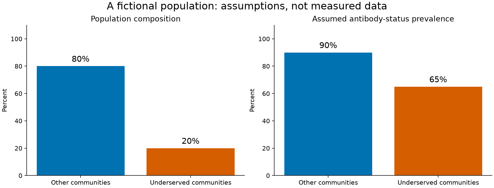
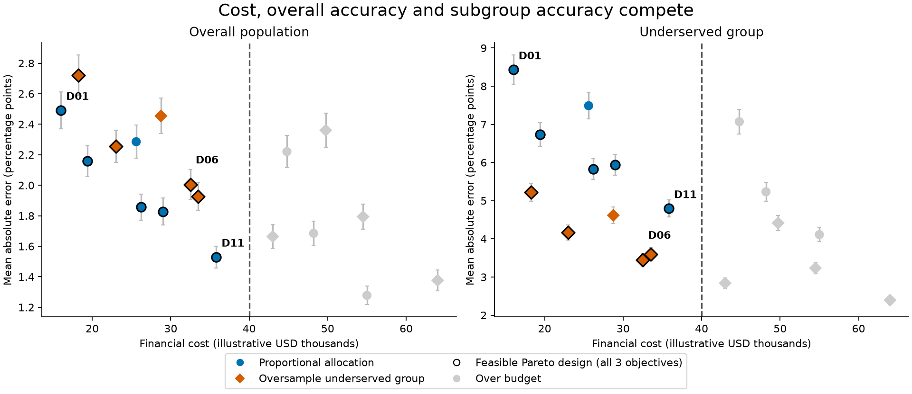
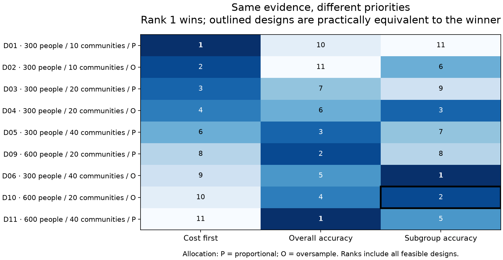
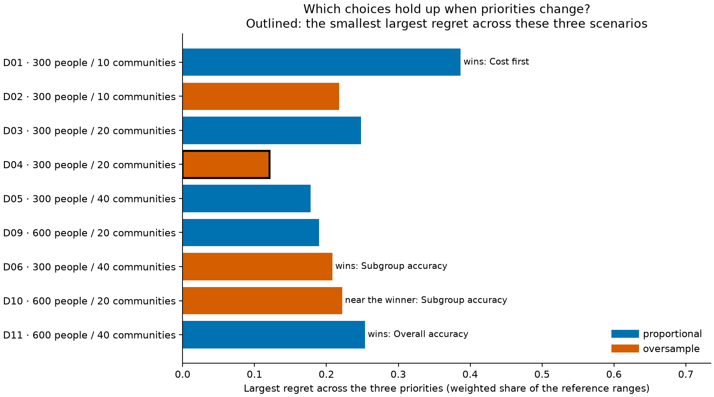
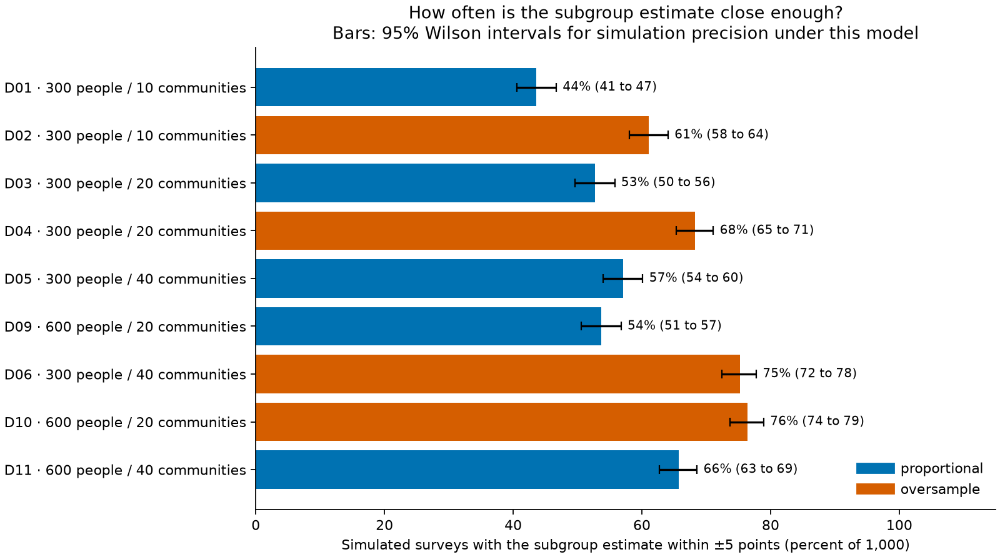
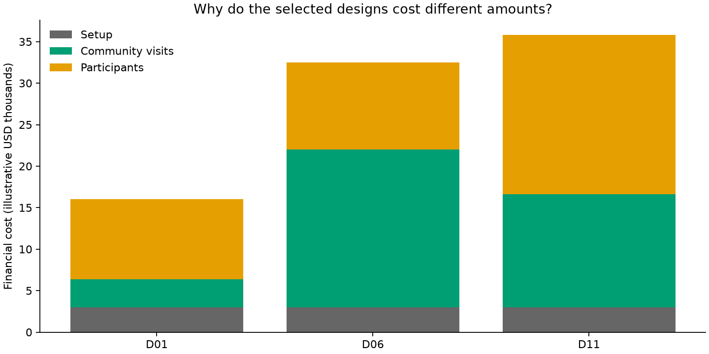
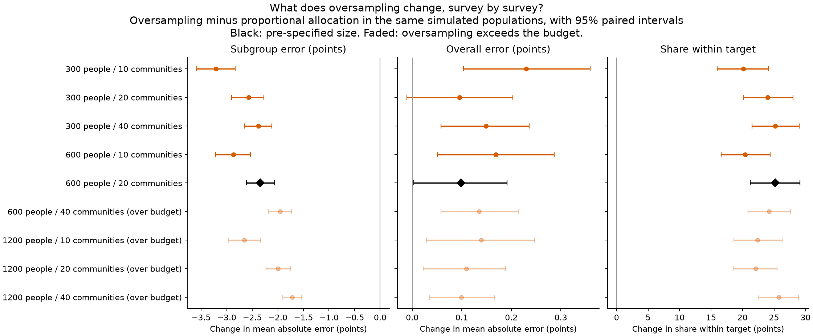
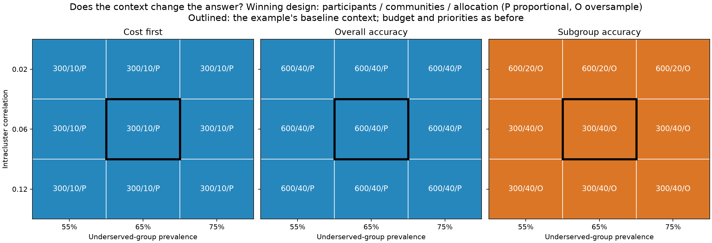
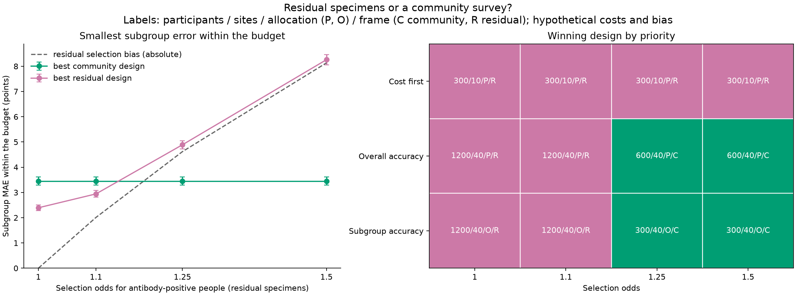

# How much survey is enough—and whose uncertainty matters?

This notebook is a 15-minute demonstration for a mixed audience at the
Johns Hopkins International Vaccine Access Center (IVAC). It compares
serosurvey designs using financial cost, overall estimation accuracy and
accuracy for an underserved group. All populations, prevalences, prices
and preference weights are hypothetical.

Open the executed
[Jupyter notebook](https://github.com/jcm-sci/trade-study/blob/main/examples/serosurvey_study.ipynb)
to read the narrative, code, tables and saved figures. The accompanying
[Python script](https://github.com/jcm-sci/trade-study/blob/main/examples/serosurvey_study.py)
contains the simulator and plotting helpers and regenerates these figures.
Use both files from a checkout; the notebook imports the companion module.
The notebook addresses the presentation audience directly. Setup commands,
export instructions and the suggested running order are collected in this guide.

## Run or present the notebook

From the repository root:

```bash
uv run --extra notebook jupyter lab examples/serosurvey_study.ipynb
```

Choose the environment's Python kernel, then restart it and run all cells.
The `notebook` extra supplies JupyterLab, nbconvert, pandas, matplotlib
and Pareto analysis without requiring the other optional modeling backends.
Installation needs network access; the executed example uses only local
code and synthetic data. The notebook needs trade-study 0.4.0 or later.

Without the development tools, clone the release and install the published
package with its notebook extra:

```bash
git clone --branch v0.4.0 https://github.com/jcm-sci/trade-study.git
cd trade-study
python -m venv .venv
source .venv/bin/activate
pip install "trade-study[notebook]==0.4.0"
jupyter lab examples/serosurvey_study.ipynb
```

The notebook imports its companion modules from the checkout and the package
from the environment.

Clean notebook executions took about 11 seconds on the development machine,
including kernel startup and rendering; the live study cell took under three
seconds. The companion script took about seven seconds for 19,800 evaluations,
the paired comparisons and seven figures. These measurements exclude dependency
installation; check your presentation machine before the talk.

Saved notebook outputs provide a fallback without running code. Export them
to HTML for an additional presentation copy:

```bash
uv run --extra notebook jupyter nbconvert --to html examples/serosurvey_study.ipynb
```

To omit the collapsed setup code from a presentation copy while keeping the
analysis code visible:

```bash
uv run --extra notebook jupyter nbconvert --to html \
  --TagRemovePreprocessor.enabled=True \
  --TagRemovePreprocessor.remove_input_tags='["hide-input"]' \
  examples/serosurvey_study.ipynb
```

To verify execution in a fresh kernel without modifying the saved notebook:

```bash
uv run --extra notebook jupyter nbconvert --execute --to notebook \
  --ExecutePreprocessor.timeout=60 --output serosurvey_executed.ipynb \
  --output-dir /tmp examples/serosurvey_study.ipynb
```

## The decision

IVAC's [SISS project](https://publichealth.jhu.edu/ivac/our-work/strengthening-immunization-systems-through-serosurveillance-siss)
examined the design and use of serological surveillance. The
[serosurvey costing study by Carcelen, Patenaude, Moss and colleagues](https://pmc.ncbi.nlm.nih.gov/articles/PMC7561102/)
provides a concrete link between epidemiology and economic evaluation.
Its study-, cluster- and participant-level cost structure motivates this
example; we do not reproduce its study or use its historical prices.

The fictional population consists of an 80% group and a 20% underserved
group, with antibody-status prevalences of 90% and 65% respectively.
These are assumed model inputs, not measured data or protection thresholds.



Compare 18 designs:

| Factor | Levels |
|---|---|
| Participants | 300, 600, 1,200 |
| Communities | 10, 20, 40 |
| Allocation | Proportional 80:20, or oversampling 50:50 |

Allocation applies to both participants and communities. Within each group,
participants are distributed as evenly as possible, keeping exact totals.

Each simulated replicate draws one fictional population: 320 communities in
the larger group and 80 in the underserved group, whose prevalences follow a
Beta distribution centered on the group mean with illustrative
within-community correlation 0.06. Every design surveys that same population.
It visits the first communities in each group's list, which is a random
sample because the list is in random order, and tests the first participants
in each; a participant has antibodies with the community's probability. Each
participant and community keeps the same random draw in every design, so
smaller designs are nested in larger ones and differences between designs are
estimated replicate by replicate (common random numbers). Replicates are
independent of one another, and each design's estimates have the same
distribution as under independent sampling. Communities are treated as large
relative to the sample, with no finite-population correction within them.
The estimand is the realized prevalence of each group in the replicate's
population (the mean over all its communities), as in a survey of a real
population; `SurveyWorld(estimand="fixed")` targets the fixed group means
instead.

The overall prevalence estimator uses population weights of 80:20 for both
allocation strategies. Oversampling does not change the population composition.
Financial cost is fixed setup plus community visit costs plus participant costs.
Average per-community and per-participant costs are not added together as if
they were independent marginal costs.

## Run, aggregate and refine

The notebook visibly constructs a `Study` with two grid `Phase`s: 100 simulated
surveys per design, followed by 1,000 per design with an independent phase seed.
Both phases evaluate all 18 designs. Refinement increases simulation replication,
not the number of participants per survey. The refined estimates replace the
screening estimates; the two phases are not pooled.

The refinement count is fixed before running. `replicates_for_half_width(0.035)`
gives 781 surveys per design for a worst-case 95% Wilson half-width of 3.5
points on the precision-target share below; the notebook checks that the 1,000
used are enough.

Each scorer call returns financial cost and absolute prevalence errors in
percentage points, and a 0/1 indicator that the underserved-group estimate is
within ±5 points of its target. `aggregate_replicates()` averages those errors, producing
mean absolute error (MAE), and retains their Monte Carlo variation. Averaging
signed errors before taking their absolute value would measure something different.

## Inspect feasible alternatives

A `Constraint` imposes an illustrative \$40,000 financial budget. The Pareto
set minimizes cost, overall MAE and underserved-group MAE simultaneously.
Subgroup error is a narrow measure of information equity, not a comprehensive
measure of equity in health outcomes.



Gray designs exceed the budget. Outlines show the feasible Pareto set computed
using all three objectives; the two panels are projections, not independently
computed two-objective fronts. Design labels identify the preference winners.
Vertical bars are approximately two Monte Carlo standard errors of estimated
MAE. They express simulation precision under this model, not uncertainty in a
real survey's prevalence or the model assumptions. They are marginal bars,
not simultaneous post-selection confidence guarantees.

## Change priorities without rerunning simulations

The notebook passes the raw results to `preference_sweep()` with three explicit
preference vectors and `normalization="reference"`. Fixed reference ranges are
\$0–70,000, 0–4 percentage points overall MAE, and 0–10 percentage points subgroup
MAE. These anchors scale preferences; they are not feasibility thresholds and
do not clip values. Scenario weights are hypothetical, not elicited stakeholder values.



Rank 1 wins within a scenario. The displayed rows are feasible Pareto designs,
but ranks include all feasible designs. Choices depend on point estimates and
can change with further simulation or different assumptions. Any reported
selection fraction describes the supplied preference scenarios, not a probability
that a design is best.

For a short live interaction, change the budget to \$30,000 in the decision
cell and rerun that cell and the figures below it. Restore the budget and edit
the subgroup-priority weights to compare another preference. No simulation
rerun is needed. If the budget admits no alternative, the example reports no choice.

## Check whether a choice holds up

Priorities are rarely settled when a survey is planned. The same sweep reports,
for each design, the scenarios it wins, its rank range and its regret: how much
worse it is than the best design under each priority, in the weighted,
reference-scaled units used for ranking. The policy also declares practical
equivalence tolerances in raw units (\$2,500 in cost, 0.25 percentage points of
overall MAE and 0.5 points of subgroup MAE). Designs within all three tolerances
of a scenario's winner form that scenario's acceptable set, and logistics or
field capacity can decide among them.



In the saved run, the subgroup-accuracy winner (300 people in 40 communities,
oversampled) has a practically equivalent alternative with twice the
participants and half the communities (outlined in the priority figure). The design with the
smallest largest regret (300 people in 20 communities, oversampled) wins no
scenario. The tolerances are judgments to agree with stakeholders; regret and
selection fractions describe only the supplied scenarios and are not
probabilities that a design is best.

## How often is an estimate close enough?

Mean absolute error is hard to act on. A planner may ask instead how often a
design estimates the underserved group within ±5 percentage points of its
target. Each simulated survey is one success or failure against the same fixed
target as the error objectives. `aggregate_replicates(proportion_observables=
["underserved_within_5pp"])` records the counts and a 95% Wilson interval for
each design; the indicator is reported and does not enter the priority weights.



In the saved run, the cost-first design meets the target in 34% of simulated
surveys, while the subgroup-accuracy winner and its practically equivalent
alternative meet it in 75% and 73%. The intervals are fixed-sample marginal
intervals for the simulation under this model. They are not the uncertainty of
a real survey's estimate, they carry no guarantee under optional stopping, and
two marginal intervals do not give an interval for the difference between two
designs, which needs the paired analysis below.

The optional cost breakdown in the appendix supports an economics discussion:



## Is oversampling worth it?

Because every design surveys the same simulated population in each replicate,
two designs can be compared survey by survey. `paired_difference()` averages
the per-replicate differences and gives a paired bootstrap interval. Before
running, the example fixes one comparison (`PAIRED_SIZE`): oversampling
against proportional allocation with 600 participants in 20 communities.

In the saved run, oversampling at that size costs \$4,500 more, lowers
subgroup MAE by 2.3 percentage points (95% paired interval 2.1 to 2.6), raises
overall MAE by 0.1 points (0.003 to 0.19) and raises the share of surveys
within the ±5-point target by 25 points (21 to 29). Pairing reduces the
Monte Carlo variance of these differences to between 60% and 89% of what
independent runs with the same per-design distributions would give.



The figure repeats the comparison at every size. Those intervals are per
comparison and not adjusted for multiplicity; sizes where oversampling exceeds
the budget are faded. `preference_sweep(paired_reference=...)` also compares
every feasible design with a reference fixed in advance (`REFERENCE_DESIGN`,
the proportional design at the same size), with intervals that hold jointly
across designs and objectives (Bonferroni). Against that reference, the two
subgroup-accuracy choices (300 people in 40 communities and 600 in 20, both
oversampled) lower subgroup MAE by 2.5 and 2.3 points. The notebook requests
the reference comparison only when the reference is within the budget. Like
the other intervals in the example, paired intervals describe simulation
precision under this model.

## Does the context change the answer?

Clustering within communities and the gap between groups are properties of the
setting, not design choices. `examples/serosurvey_contexts.py` runs the 18
designs in nine contexts (intracluster correlation 0.02, 0.06 or 0.12;
underserved-group prevalence 55%, 65% or 75%) with 1,000 simulated surveys each.
Context and design keys stay separate in every configuration, and the
recommendations are computed within each context with the same budget,
priorities and tolerances. The per-design summaries, including the indicator
intervals, are saved as a version-1 result bundle in
`examples/data/serosurvey_contexts/` with provenance: SHA-256 of the model and
script, the contexts, seed, replicate count, objectives and decision settings.
The notebook loads and validates the bundle instead of rerunning. To regenerate
it and the figure (about 20 seconds):

```bash
uv run --extra notebook python -m examples.serosurvey_contexts --overwrite
```



In the saved run, the cost-first and overall-accuracy winners are the same in
all nine contexts. Under the subgroup-accuracy priority, the winner changes
only with clustering: at intracluster correlation 0.02, 600 people in 20
communities wins, and at 0.06 and 0.12, 300 people in 40 communities wins, at
every underserved prevalence. The baseline context reproduces the main
notebook's results exactly, because it uses the same seed and replicate
populations. Random streams depend only on the seed and replicate, so every
design in every context uses the same participant draws; community prevalences
come from the same stream under each context's values. The grid has nine
points; interpolating between them (for example with `fit_regime_surrogate`
and its support warnings) is a possible extension.

## Residual specimens or a community survey?

Residual blood specimens collected at health facilities and laboratories can
cost less than a household survey. In parallel facility and household
serosurveys in India, Prosperi and colleagues found
[similar age-specific measles and rubella seroprevalence in adults](https://doi.org/10.1017/S0950268824001389);
in children, rubella seroprevalence rose similarly in both sources after a
vaccination campaign, but
[measles trends were inconsistent between them](https://doi.org/10.1017/S0950268824001353).
Residual specimens can be biased when the people who provide them differ in
antibody status from their community, for example when facility use is linked
to vaccination. Community surveys can also miss people
([Kostandova and colleagues](https://doi.org/10.1371/journal.pgph.0003072)).

`examples/serosurvey_frames.py` adds a `frame` design factor (`community` or
`residual`) to the 18 designs. A residual design collects specimens from
facilities serving the same sampled communities, with the same clustering and
allocation. It has the same setup cost, a facility coordination cost in place
of community visits and a lower cost per specimen, all invented. Selection is
described by one number per group, the selection odds ψ: among residual
specimens from a community with prevalence π, the odds of antibody positivity
are ψ times the community odds, so the prevalence among specimens is
ψπ / (ψπ + 1 − π). Equivalently, antibody-positive people are ψ times as
likely to contribute a specimen. Specimens use the same random draws as a
community survey of the same communities, so with ψ = 1 the residual frame
reproduces the community survey's estimates exactly, at a lower cost. The
estimand is still the population's realized prevalence.

The script runs the 36 designs at ψ = 1, 1.1, 1.25 and 1.5 in both groups,
with 1,000 simulated surveys each, and saves a result bundle with the selection
model, costs and seed in its provenance (`examples/data/serosurvey_frames/`).
To regenerate it and the figure (about 20 seconds):

```bash
uv run --extra notebook python -m examples.serosurvey_frames --overwrite
```



In the saved run, residual specimens overstate the underserved group's
prevalence by about 2.0, 4.6 and 8.1 points at ψ = 1.1, 1.25 and 1.5. Without
selection bias, and at ψ = 1.1, residual specimens win all three priorities:
the budget buys 1,200 specimens from 40 facilities, and the smallest subgroup
MAE within the budget is 2.4 and 2.9 points, against 3.45 for the best
community survey (300 people in 40 communities, oversampled). At ψ = 1.25 and
1.5 community surveys win both accuracy priorities, because testing more
specimens does not remove the bias; mean absolute error cannot fall below the
absolute bias. The cost-first priority picks the cheapest residual design at
every ψ, so a cost-first choice accepts the bias.

The model is deliberately simple: one multiplicative selection on antibody
status, applied equally to both groups, with no structure by age, sex or
care-seeking, and a complete community frame. Selection cannot be estimated
from residual specimens alone; a real comparison would estimate it from paired
facility and community data, as in the studies above.

## A 15-minute presentation

| Minutes | Content |
|---|---|
| 0–2 | The decision and the two population groups |
| 2–4 | Design factors and competing objectives |
| 4–6 | One visible `Study` definition and a live run |
| 6–10 | Budget and Pareto plots |
| 10–11 | Priorities and an optional budget change |
| 11–13 | Regret and practically equivalent designs |
| 13–14 | Assumptions a real project would replace |
| 14–15 | Discussion |

For a 20-minute version, add the precision target (section 7 of the notebook)
after the regret segment. The paired comparison of oversampling (section 8) can
serve as a backup slide for questions about allocation, and the
sampling-frame comparison (section 10) as a backup for questions about
residual specimens.

The notebook's setup cells are collapsed, and slideshow metadata identifies
the main narrative and its figures. The model details and cost breakdown are
technical appendices. Use this guide's running order and budget/priority changes
to prepare the presentation; saved notebook outputs and HTML support a version
without live execution.

## What a real project would replace

Replace the synthetic population with context-specific prevalence, clustering,
nonresponse and sampling-frame assumptions; add validated assay characteristics
and uncertainty; use local financial and economic costs; and define objectives
and practical constraints with stakeholders. The example holds assay effects
fixed and does not equate antibody-status prevalence with complete protection.
Community surveys are sampled without selection bias by construction, and
residual-specimen selection is one assumed number. Real selection
and nonresponse can introduce bias that more simulation cannot remove.

The notebook's references link to related serosurveillance work and its costing
literature. They provide context for the scientific question; the numerical
assumptions are illustrative.

## Export the results

From a notebook code cell, export the per-design scores and decision metadata:

```python
report.summary.to_dataframe(include_metadata=True).to_csv(
    "serosurvey_designs.csv", index=False
)
```

To regenerate documentation figures:

```bash
uv run --extra notebook python examples/serosurvey_study.py
```
