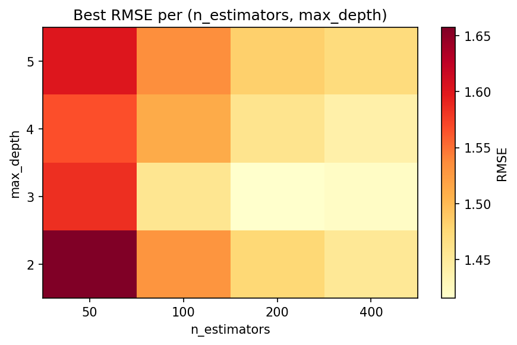
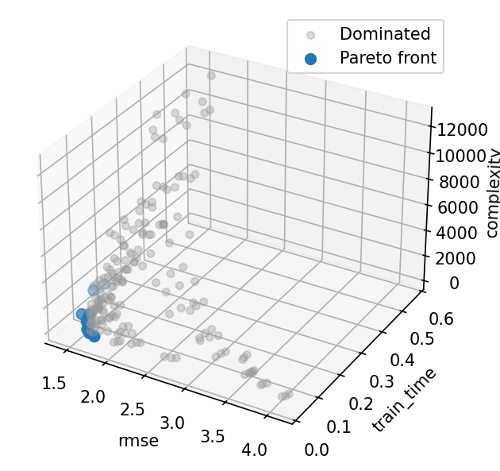
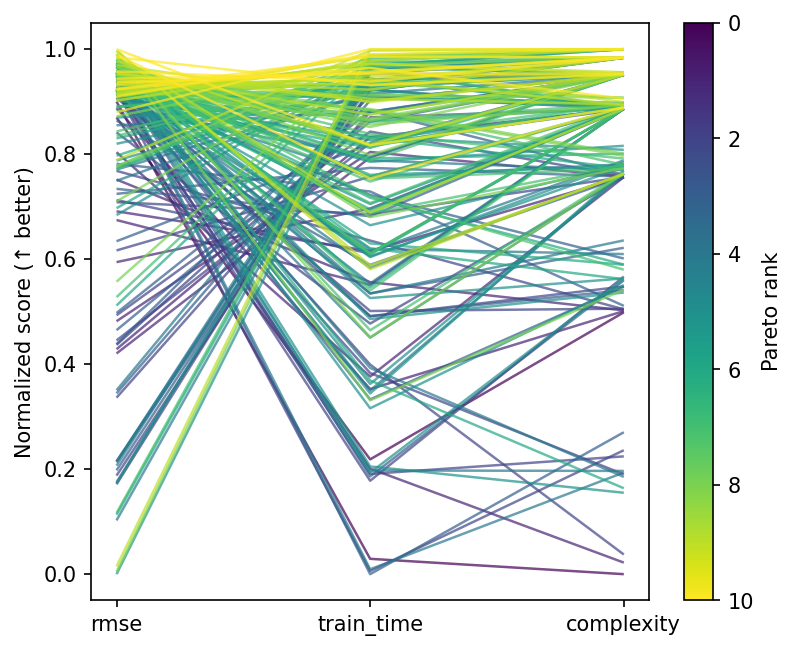
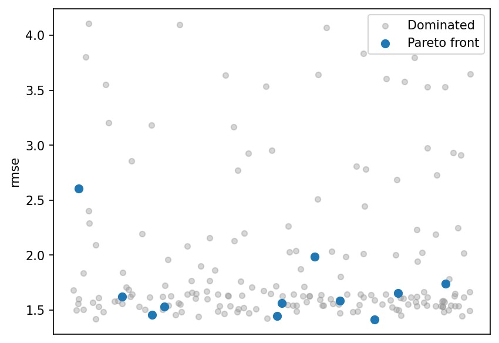

# Hyperparameter Trade Study

This tutorial runs a **multi-objective hyperparameter sweep** over
scikit-learn's `GradientBoostingRegressor`, balancing prediction
accuracy against training cost and model complexity.

!!! tip "Run it yourself"

    The full runnable script is at
    [`examples/sklearn_study.py`](https://github.com/jcm-sci/trade-study/blob/main/examples/sklearn_study.py).

    ```bash
    pip install scikit-learn
    uv run python examples/sklearn_study.py
    ```

## The problem

This example compares prediction error, training time, and model size.
The preferred balance depends on the application's computing and accuracy
requirements.

This example treats hyperparameter selection as a **multi-objective
design-of-experiments** problem with three competing objectives:

| Objective | Direction | What it measures |
|-----------|-----------|------------------|
| RMSE | minimize | Root mean squared error on a held-out test set |
| Training time | minimize | Wall-clock seconds to `fit()` the model |
| Complexity | minimize | Total number of leaf nodes across all trees |

### Why the objectives conflict

- More estimators increase the number of trees and training work. Their effect
  on held-out error depends on the data and other settings.
- Deeper trees permit more leaves and can change both fit and generalization.
- Learning rate controls each tree's contribution to the prediction.
- Subsampling changes the training data used for each tree and the variability
  of gradient estimates.

Pareto analysis identifies configurations that are nondominated across the
three measured objectives.

## Dataset

We use scikit-learn's `make_friedman1`, a standard synthetic regression
benchmark.  The true function is:

$$y = 10\sin(\pi x_1 x_2) + 20(x_3 - 0.5)^2 + 10 x_4 + 5 x_5 + \varepsilon$$

where $\varepsilon \sim \mathcal{N}(0, 1)$ and $x_6, \dots, x_{10}$
are noise features.  We generate 800 samples and hold out 25 % for
testing:

```python
--8<-- "examples/sklearn_study.py:dataset"
```

## Simulator and scorer

In `trade-study`, every experiment needs a **Simulator** and a
**Scorer**:

- The **Simulator** wraps model training.  Its `generate()` method
  receives a hyperparameter config, fits a `GradientBoostingRegressor`,
  and returns the test-set ground truth plus predictions and metadata
  (training time, leaf count).
- The **Scorer** extracts the three objective values from each trial.

```python
--8<-- "examples/sklearn_study.py:world"
```

## Define observables and factors

**Observables** tell `trade-study` *what* you're measuring and which
direction is better:

```python
--8<-- "examples/sklearn_study.py:observables"
```

**Factors** define the hyperparameter search space.  We use discrete
levels so a full factorial grid is tractable
($4 \times 4 \times 4 \times 3 = 192$ combinations):

```python
--8<-- "examples/sklearn_study.py:factors"
```

## Run the sweep

`build_grid` with `method="full"` generates every combination.
`run_grid` evaluates them all and returns a `ResultsTable`:

```python
--8<-- "examples/sklearn_study.py:run"
```

## Hyperparameter landscape

Before looking at the Pareto front, it helps to see how RMSE varies
across two hyperparameters. The heatmap below
shows the **best RMSE** achieved at each (n_estimators, max_depth)
combination, minimised over learning rate and subsample fraction:



Compare this error surface with training time and leaf count. Additional
trees or depth do not ensure lower held-out error.

## Inspect the Pareto front

`extract_front` retains configurations for which no other evaluated design
is at least as good on every objective and strictly better on one. The
front is defined by this grid and the measured outcomes.

```python
--8<-- "examples/sklearn_study.py:results"
```

Front membership can change with the dataset, seed, and measured training time.
A practitioner can choose based on priorities, such as selecting
the lowest-RMSE design if accuracy is paramount, or the fastest design
that still meets an RMSE threshold.

### Pareto front scatter matrix



Each dot is one hyperparameter combination; highlighted points lie on
the Pareto front.  The off-diagonal panels expose pairwise trade-offs
between RMSE, training time, and leaf count.

### Parallel coordinates



Every line is one design, coloured by Pareto membership. Compare the
hyperparameter ranges occupied by the evaluated front.

### RMSE strip plot



Scores for each design, split by Pareto membership. A design may remain on
the front because it is faster or smaller despite having higher RMSE.

## What to try next

- Use `build_grid(factors, method="lhs", n_samples=50)` for a Latin
  hypercube design with continuous hyperparameters.
- Wrap the sweep in a `Study` with multiple phases. Screen first,
  then refine the promising region.
- Add an `Annotation` for dollar cost (e.g., cloud compute pricing per
  second) to include cost as a non-simulated objective.
- Use `save_results()` / `load_results()` to persist results across
  sessions.
